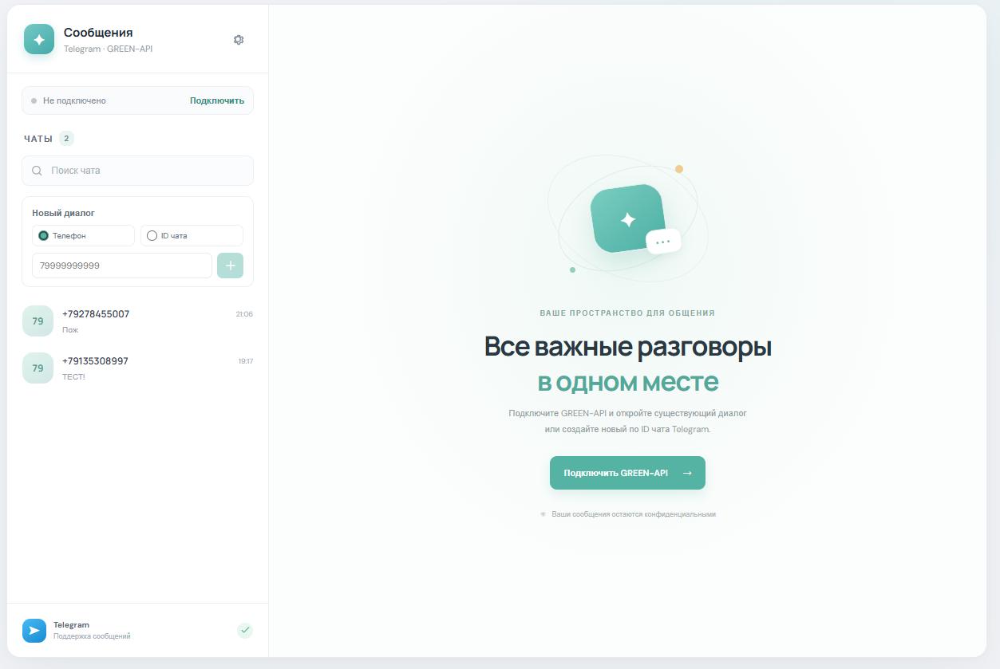
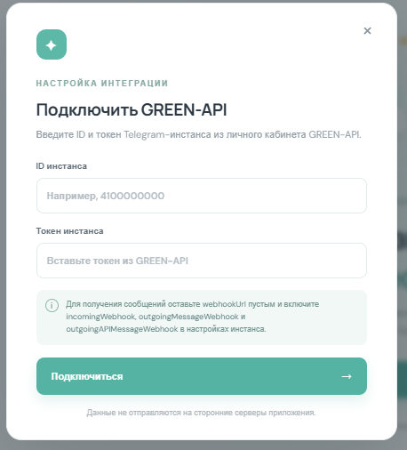
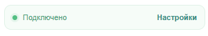
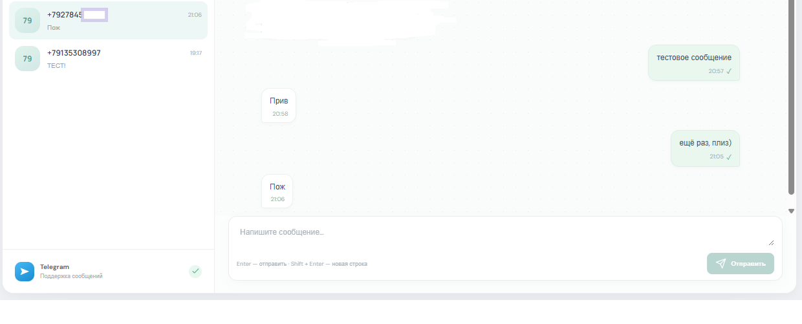

# Telegram-чат через GREEN-API

Небольшое приложение на React и TypeScript для отправки и получения текстовых сообщений Telegram через [GREEN-API](https://green-api.com/telegram/docs/api/). Диалоги можно создавать по номеру телефона или по ID чата.

## Подготовка

1. Создайте Telegram-инстанс в [личном кабинете GREEN-API](https://console.green-api.com/) и авторизуйте его.
2. Скопируйте **ID инстанса** и **токен инстанса**. Они понадобятся в приложении; API URL вводить не нужно.
3. В настройках инстанса оставьте `webhookUrl` пустым и включите получение уведомлений о входящих сообщениях (`incomingWebhook`), исходящих сообщениях с телефона (`outgoingMessageWebhook`) и исходящих сообщениях через API (`outgoingAPIMessageWebhook`).

## Локальный запуск

Нужны Git, Node.js 18+ и npm. Выполните:

```bash
git clone https://github.com/Narzar-dev/green-api-telegram-chat.git GreenApi
cd GreenApi
npm install
npm run dev
```

Откройте адрес **http://localhost:4173/**. После запуска вы увидите главный экран со списком диалогов слева и кнопкой подключения.



## Подключение и работа с сообщениями

### 1. Подключите GREEN-API

Нажмите **«Подключить»** в левой панели или **«Подключить GREEN-API»** в центре экрана. Введите ID и токен Telegram-инстанса, затем нажмите **«Подключиться»**.



Когда данные сохранены, в левой панели появится статус **«Подключено»**.



ID и токен хранятся только в состоянии открытой страницы. После её перезагрузки подключитесь повторно.

### 2. Создайте диалог

В блоке **«Новый диалог»** выберите тип получателя:

- **Телефон** — введите номер только цифрами, например `79999999999`. При отправке приложение добавит к номеру `@c.us`.
- **ID чата** — введите ID личного или группового чата Telegram. Он отправляется без суффикса.

Нажмите **«+»** и откройте созданный диалог в списке. Чтобы найти существующий диалог, воспользуйтесь полем **«Поиск чата»**.

### 3. Отправьте сообщение и дождитесь ответа

Напишите текст в нижнем поле и нажмите **«Отправить»** или `Enter`. Для новой строки используйте `Shift + Enter`. Исходящие сообщения отображаются справа, входящие — слева.



Приложение получает новые сообщения через очередь уведомлений GREEN-API. Открытый диалог также сверяется с историей примерно раз в 20 секунд, чтобы показать пропущенный ответ. Повторные сообщения не добавляются второй раз; история диалогов хранится в `localStorage` браузера.

## Проверка и сборка

```bash
npm test
npm run build
npm start
```

`npm test` запускает тесты, `npm run build` проверяет типы и собирает приложение, `npm start` открывает локальный просмотр готовой сборки.

## Структура проекта

| Путь | Назначение |
| --- | --- |
| `src/components/` | Компоненты интерфейса |
| `src/api/greenApi.ts` | Запросы к GREEN-API и разбор уведомлений |
| `src/entities/chat.ts` | Типы диалогов, объединение сообщений и сохранение истории |
| `src/hooks/` | Получение уведомлений, сверка истории и состояние диалогов |
| `tests/` | Тесты API и логики диалогов |
| `docs/screenshots/` | Изображения для этой инструкции |

Документация GREEN-API: [Telegram API](https://green-api.com/telegram/docs/api/), [получение уведомлений](https://green-api.com/telegram/docs/api/receiving/technology-http-api/), [история чата](https://green-api.com/telegram/docs/api/journals/GetChatHistory/).
